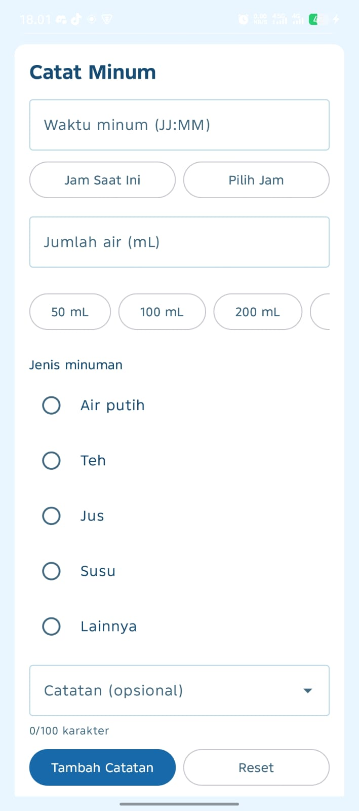
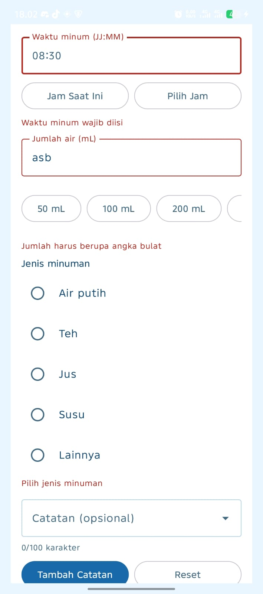
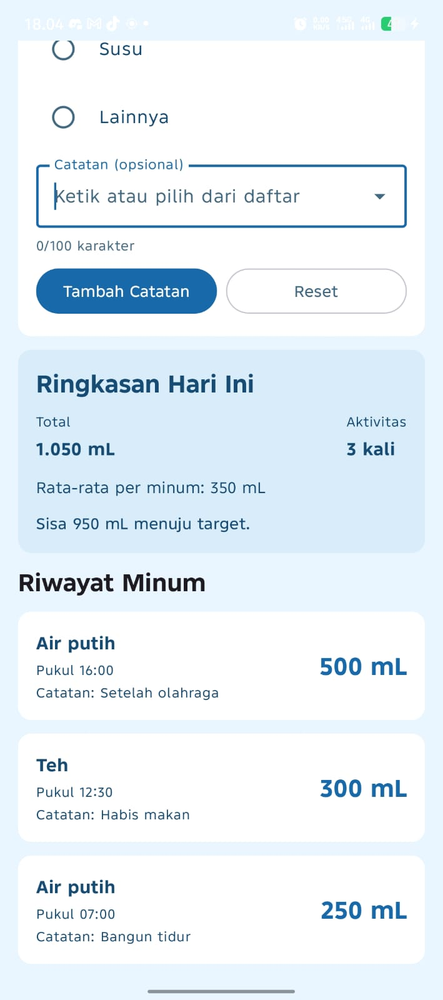
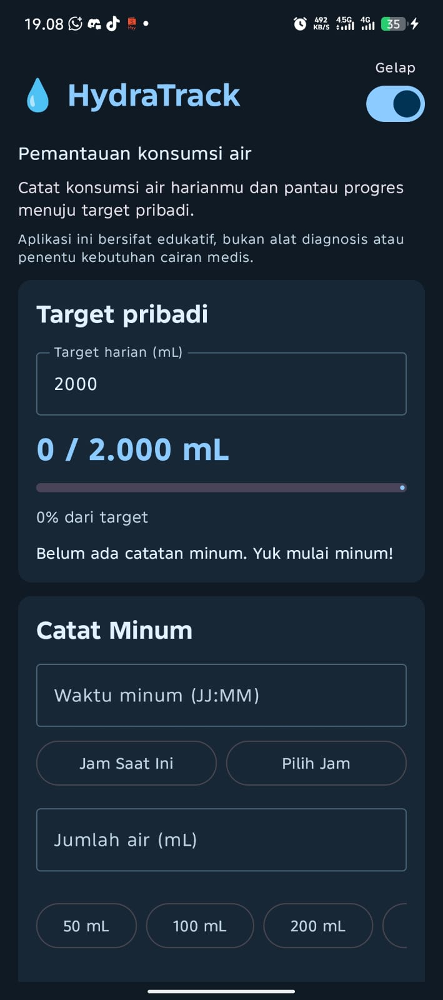

# 💧 HydraTrack (HT-02)

Prototipe aplikasi Android untuk **mencatat konsumsi air** dan memantau progres terhadap **target pribadi** yang ditentukan sendiri oleh pengguna.

Proyek UTS Pemrograman Bergerak (SSI3140) — Program Studi Sistem Informasi, Universitas Ma Chung.
Bagian dari payung proyek **HealthTrack Mobile Suite**.

## Anggota Kelompok

| NIM       | Nama                                  | Peran utama                                                      |
| --------- | ------------------------------------- | ---------------------------------------------------------------- |
| 322410004 | Farid Heka Magfirio                   | Kerangka aplikasi, model data, logika & validasi, refactor       |
| 322410010 | Lucas Vincent Kurniawan Obedius Nobel | UI Jetpack Compose, tema gelap/cerah, input waktu, pilihan cepat |

## Masalah

Kesibukan kuliah dan kerja membuat orang mudah lupa minum. HydraTrack membantu mencatat setiap aktivitas minum dan menampilkan progres terhadap target pribadi, sebagai sarana _self-monitoring_ dan edukasi.

## Pengguna Sasaran

- Mahasiswa
- Pekerja
- Masyarakat umum

## Fitur

- **Target pribadi** harian dengan progress bar, persentase, dan pesan sesuai progres
- **Form pencatatan**: waktu minum, jumlah air (mL), jenis minuman, catatan
- Input waktu: ketik manual, tombol **Jam Saat Ini**, atau **Pilih Jam** (TimePicker)
- **Pilihan cepat** jumlah air 50–500 mL (LazyRow)
- **Catatan cepat** lewat dropdown (Bangun tidur, Setelah olahraga, dll.) dengan penghitung karakter
- **Validasi input** dengan pesan kesalahan, tanpa crash; pesan hilang saat input diperbaiki
- **Riwayat minum** dengan LazyColumn dan Card, data terbaru paling atas
- **Empty state** ketika belum ada catatan
- **Ringkasan otomatis**: total volume, jumlah aktivitas, rata-rata per minum, sisa menuju target
- **Mode gelap/cerah** lewat Switch
- Tombol **Reset** untuk mengembalikan form dan target ke kondisi awal

## Struktur Kode

| File              | Isi                                                                                                    |
| ----------------- | ------------------------------------------------------------------------------------------------------ |
| `CatatanMinum.kt` | Model data (`data class`) satu catatan minum                                                           |
| `HydraLogic.kt`   | Batas validasi (`HydraRules`), daftar jenis minuman, fungsi validasi, dan fungsi perhitungan ringkasan |
| `MainActivity.kt` | Tampilan Jetpack Compose dan pengelolaan state                                                         |

## Model Data

```kotlin
data class CatatanMinum(
    val id: Int,
    val waktu: String,
    val jumlahMl: Int,
    val jenisMinuman: String,
    val catatan: String
)
```

Target pribadi disimpan terpisah sebagai state karena berlaku untuk satu hari, bukan untuk setiap catatan.

## Aturan Validasi

| Input         | Aturan                            |
| ------------- | --------------------------------- |
| Waktu         | Wajib, format JJ:MM (00:00–23:59) |
| Jumlah air    | Wajib, angka bulat, 1–2000 mL     |
| Jenis minuman | Wajib dipilih                     |
| Target harian | Wajib, angka bulat, 500–5000 mL   |
| Catatan       | Opsional, maksimal 100 karakter   |

## Logika dan Ringkasan

| Fungsi           | Kegunaan                                                      |
| ---------------- | ------------------------------------------------------------- |
| `hitungTotal`    | Menjumlahkan seluruh `jumlahMl`                               |
| `hitungRataRata` | Total dibagi jumlah catatan (0 jika kosong)                   |
| `hitungProgres`  | Persentase total terhadap target                              |
| `hitungSisa`     | Sisa mL menuju target, minimal 0                              |
| `pesanProgres`   | Klasifikasi pesan: belum ada catatan, < 50%, < 100%, tercapai |

## Cara Menjalankan

1. Clone repository ini.
2. Buka folder proyek di Android Studio.
3. Tunggu proses Gradle Sync selesai.
4. Pilih konfigurasi **app**, lalu klik ▶ Run ke emulator atau HP Android (minimal Android 7.0 / API 24).

Atau pasang langsung file APK `UTS_PemrogramanBergerak_HT-02_HydraTrack.apk`.

## Screenshot

| Tampilan awal                        | Validasi error                         | Data terisi                          | Tema gelap                             |
| ------------------------------------ | -------------------------------------- | ------------------------------------ | -------------------------------------- |
|  |  |  |  |

Wireframe: [docs/wireframe.png](docs/wireframe.png)

## Hasil Pengujian

Lihat [docs/test-cases.md](docs/test-cases.md). Ringkasan: [isi, contoh: 12 dari 12 skenario lulus].

## Batasan UTS

- Data hanya disimpan sementara di memori, sehingga hilang saat aplikasi ditutup.
- Satu layar, tanpa database dan navigasi.
- Aplikasi bersifat **edukatif**: bukan alat diagnosis, tidak menentukan kebutuhan cairan medis, dan **tidak untuk pasien dengan pembatasan cairan**.
- Menggunakan data simulasi.

## Rencana UAS

- Room Database dan CRUD lengkap (tambah, lihat, ubah, hapus)
- Navigation Compose dengan minimal tiga layar (daftar, form, detail/rekap)
- Riwayat dan filter tanggal
- Pengaturan target yang tersimpan
- Pengayaan: grafik dan notifikasi pengingat minum
